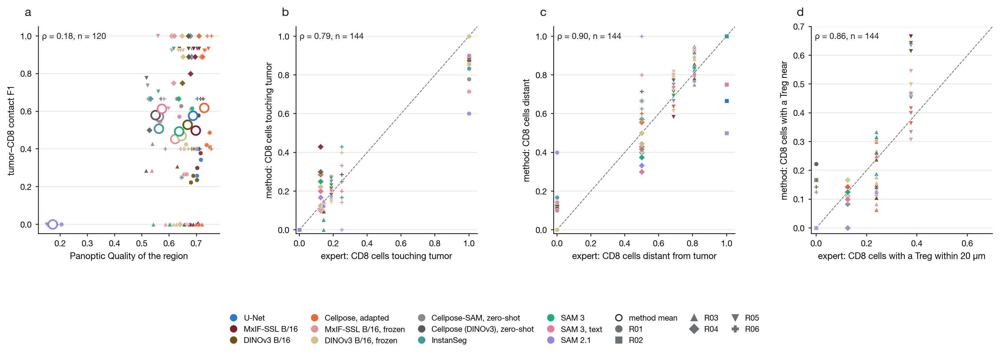
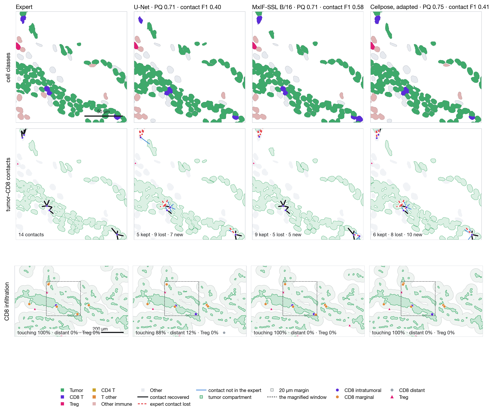

<div align="center">

# Beyond Segmentation Accuracy

**Evaluating biological fidelity in spatial pathology: an expert-curated multiplex-immunofluorescence cell-segmentation benchmark, one leave-slide-out protocol for twelve segmenters, and a four-level evaluation that follows every method's cells into phenotypes, neighborhoods and tumor–immune organization**

[](https://github.com/marjanstoimchev/beyond-segmentation-accuracy/actions/workflows/ci.yml)
[](LICENSE)
[](https://openreview.net/forum?id=mD2Cb5rqWd)
[](https://www.python.org/)
[](https://lightning.ai/)

[Quick start](docs/QUICKSTART.md) ·
[Data](docs/DATA.md) ·
[Pipeline](docs/PIPELINE.md) ·
[Experiments](docs/EXPERIMENTS.md) ·
[Notebooks](docs/NOTEBOOKS.md) ·
[Results](docs/RESULTS.md) ·
[Development](docs/DEVELOPMENT.md)

</div>

---

> **Research and non-commercial use only.** This code is released under the
> [PolyForm Noncommercial License 1.0.0](LICENSE): academic, research and other non-commercial use is free;
> commercial use of any kind is not permitted without a separate license (contact the authors).
> If this benchmark or code contributes to your work, please **cite the paper** (see [Citation](#citation)).

**The problem.** Multiplex immunofluorescence (MxIF) resolves cellular identity, state and spatial organization within
tumor tissue, but every downstream representation of the tumor microenvironment — marker quantification, phenotypes,
cell–cell neighborhoods, tumor–immune organization — rests on one deceptively simple first step: finding the individual
cells. Segmentation benchmarks report instance accuracy. They do not say whether a better instance score yields a more
faithful biological picture.

**What this repository does.** It tests that relationship directly. An expert-curated benchmark of more than 21,000
cells on three CellDIVE slides (every cell reviewed, HALO's errors flagged) is scored under a leave-slide-out protocol:
one development slide for pretraining, training and model selection, two slides held out at every stage. Twelve
segmenters — a U-Net, a domain-specific self-supervised encoder ([KODIAK](https://github.com/marjanstoimchev/KODIAK),
adapted to multiplex tissue; "MxIF-SSL" in the anonymized paper), its DINOv3 initialization, frozen-encoder probes,
Cellpose (zero-shot and fine-tuned), InstanSeg, and the prompted generalists SAM 2.1 and SAM 3 — are trained and
evaluated under one protocol, and every method's predicted cells pass through the same downstream pipeline. Fidelity is
measured at four levels: cell segmentation, phenotype assignment, spatial neighborhood structure, and tumor–immune
organization.

<p align="center">
  
</p>
<p align="center"><em>Tumor–CD8<sup>+</sup> contact recovery, the most stringent spatial test, against Panoptic Quality on the test slide
(a; one point per run and region, rings = method means): conventional segmentation quality barely predicts it (ρ = 0.18),
while the coarser infiltration statistics are preserved by almost every method (b–d).</em></p>

**What it finds.** The levels do not improve in lockstep. Phenotype assignment is robust to segmentation differences
(96–97 % lineage agreement for every trained row), whereas missed cells increasingly disrupt neighborhood structure and
tumor–immune interactions. Methods with nearly identical segmentation accuracy produce substantially different
biological representations: at equal Panoptic Quality on the same region, one method keeps 9 of 14 expert tumor–CD8
contacts and another keeps 5.

<p align="center">
  
</p>
<p align="center"><em>One region of the test slide read four ways. Rows: cell classes, tumor–CD8 contacts (black recovered, red lost, blue invented),
CD8 infiltration zones. Columns: the expert reference and three methods with the same PQ and different contact fidelity.</em></p>

This is the official implementation of

> **Beyond Segmentation Accuracy: Evaluating Biological Fidelity in Spatial Pathology**
> N. Dimitrova, M. Stoimchev, A. Filliol, S. Flowers, P. Romesser, S. Lowe
> *NeurIPS 2026 Workshop on AI at Scale for Clinical Impact: Cancer Pathology Foundation Models (ASCI)* ·
> [OpenReview](https://openreview.net/forum?id=mD2Cb5rqWd)

## Highlights

- **An expert-curated benchmark**: 32,816 HALO nuclei on three slides, every one reviewed cell by cell, 7,115 flagged as
  HALO's errors. Models learn only from confirmed cells; flagged cells are neither targets nor false positives.
- **Leave-slide-out**: Slide 1 develops everything (pretraining on its unlabeled tissue, training, checkpoint selection,
  gates, analysis settings); Slides 2 and 3 are touched once, for the final scoring of each finished run.
- **Twelve rows, one protocol**: the same patches, input (LAP2 · — · DAPI, the channels the reference was drawn from),
  optimizer, budget and three seeds for every trained model; zero-shot and prompted rows declared by one YAML each.
- **Four levels of fidelity**: whole-region instance metrics; marker quantification and hierarchical phenotypes under
  calibrated gates; cell-graph edges and neighborhood composition; tumor–CD8 contacts, infiltration and Treg proximity.
- **One data pipeline** (`mxdata`): CellDIVE OME-TIFFs + HALO layers + review tables → a fixed dataset of 256² patches
  carrying every marker, validated, resumable, with the split and normalization stored once and used everywhere.
- **Reproducible from the configs**: every table and figure comes from `configs/`, `scripts/finetune_all.sh` and the
  notebooks; the metrics of every run are versioned here.

## Install and run

```bash
pip install torch torchvision                                  # the build for your platform, https://pytorch.org
pip install -e ".[train,kodiak,notebooks,dev]"                 # mxdata + mxseg + kodiak and the notebook stack
make test                                                      # synthetic slides, no data needed, ~1 min

export MXDATA_ROOT=/path/to/slides                             # folder holding SLIDE-*/ (see docs/DATA.md)
make data                                                      # the dataset: $MXDATA_ROOT/dataset/
python -m kodiak.pretrain -c configs/kodiak_pretrain_vitb.yaml # KODIAK ViT-B/16 on the development slide -> runs/kodiak_mxif_vitb
scripts/finetune_all.sh --epochs 10 --zero-shot                # every row x 3 seeds, each scored on the test slides -> results/
```

Then the notebooks, `02 → 03 → 04 → 05` and `analyses/10`, turn the stored predictions into the four-level analysis.
The [quick start](docs/QUICKSTART.md) walks through all of it; [Experiments](docs/EXPERIMENTS.md) lists every row's command.

## Documentation

| | |
|---|---|
| [Quick start](docs/QUICKSTART.md) | Installation, smoke test, data → pretrain → train → evaluate → analyze, where everything lands |
| [Data](docs/DATA.md) | The slides, annotations and review tables; the dataset of patches; the QC rule; the phenotype label store |
| [Pipeline](docs/PIPELINE.md) | ingest → validate → plan → stats → sample → serve, and what makes it resumable and testable |
| [Experiments](docs/EXPERIMENTS.md) | The protocol, every row of the paper as a command, the inputs, KODIAK pretraining on MxIF |
| [Notebooks](docs/NOTEBOOKS.md) | One notebook per analysis, what each reads and writes, in what order to run them |
| [Results](docs/RESULTS.md) | The current numbers on both held-out slides, per level |
| [Development](docs/DEVELOPMENT.md) | Tests, lint, CI, project layout, practices the code follows |

## Results at a glance

Slide 2 (SLIDE-0236, six expert-reviewed regions, 6,152 confirmed cells; mean over three seeds, 10-epoch budget).
The full tables, Slide 3, and the downstream levels are in [docs/RESULTS.md](docs/RESULTS.md).

| Method | F1@0.5 | PQ | AP@0.5:0.9 | tumor–CD8 contact F1 |
|---|---|---|---|---|
| Cellpose (DINOv3 B/16), fine-tuned | **0.901** | **0.726** | **0.551** | **0.62** |
| KODIAK B/16, fine-tuned | 0.877 | 0.697 | 0.504 | 0.50 |
| U-Net (flow objective) | 0.875 | 0.685 | 0.480 | 0.58 |
| DINOv3 B/16, fine-tuned | 0.863 | 0.665 | 0.451 | 0.53 |
| DINOv3 B/16, frozen encoder | 0.840 | 0.644 | 0.424 | 0.47 |
| KODIAK B/16, frozen encoder | 0.814 | 0.618 | 0.392 | 0.45 |
| SAM 3, exemplar prompts | 0.842 | 0.633 | 0.403 | 0.49 |
| SAM 3, text prompt | 0.805 | 0.568 | 0.308 | 0.61 |
| Cellpose-SAM, zero-shot | 0.781 | 0.550 | 0.292 | 0.57 |
| Cellpose (DINOv3), zero-shot | 0.781 | 0.541 | 0.276 | 0.58 |
| InstanSeg, zero-shot | 0.766 | 0.556 | 0.313 | 0.51 |
| SAM 2.1, prototype prompts | 0.270 | 0.168 | 0.049 | 0.00 |

Instance accuracy and the biological endpoint rank the methods differently: the three best segmenters span 0.50–0.62 on
contact fidelity, and zero-shot rows with far lower PQ keep as many contacts as the best fine-tuned ones.

## Data

The CellDIVE slides and the expert annotations are not distributed with the code. [docs/DATA.md](docs/DATA.md) documents
the on-disk layout the pipeline expects (one folder per slide: OME-TIFFs, HALO GeoJSON layers, review tables, phenotype
labels), so the pipeline runs unchanged on any CellDIVE + HALO export; the test suite builds a synthetic slide in that
layout, so everything can be exercised without the data.

## Citation

If this benchmark or code contributes to your work, please cite the paper:

```bibtex
@inproceedings{dimitrova2026beyond,
  title     = {Beyond Segmentation Accuracy: Evaluating Biological Fidelity in Spatial Pathology},
  author    = {Nevenka Dimitrova and Marjan Stoimchev and Aveline Filliol and Sara Flowers and Paul Romesser and Scott Lowe},
  booktitle = {AI at Scale for Clinical Impact: Cancer Pathology Foundation Models (NeurIPS 2026 Workshop)},
  year      = {2026},
  url       = {https://openreview.net/forum?id=mD2Cb5rqWd}
}
```

The self-supervised encoder is KODIAK; if you use it, please also cite
[its paper](https://github.com/marjanstoimchev/KODIAK#citation).

## License

The code (`src/mxdata`, `src/mxseg`, `src/kodiak`, `scripts/`, `configs/`, `tests/`, `docs/`, `notebooks/`, `media/`) is
released under the [PolyForm Noncommercial License 1.0.0](LICENSE). In short:

- **Allowed**: use, modification and redistribution for research, teaching, personal and other non-commercial purposes,
  including by universities, research institutes and hospitals doing research.
- **Not allowed**: any commercial use (products, services, consulting, commercial R&D) without a separate license.
  For commercial licensing, contact the authors.
- **Please cite and acknowledge** the paper in publications, reports or software that build on this code.

The vendored DINOv3 layers (`src/dinov3/`) are distributed by Meta under the
[DINOv3 License Agreement](src/dinov3/LICENSE.md). The pretrained weights the baselines download (DINOv3, Cellpose,
InstanSeg, SAM 2.1, SAM 3) remain under their own licenses.
