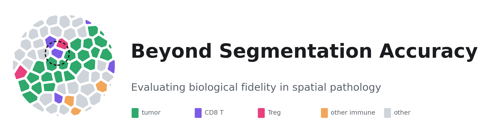
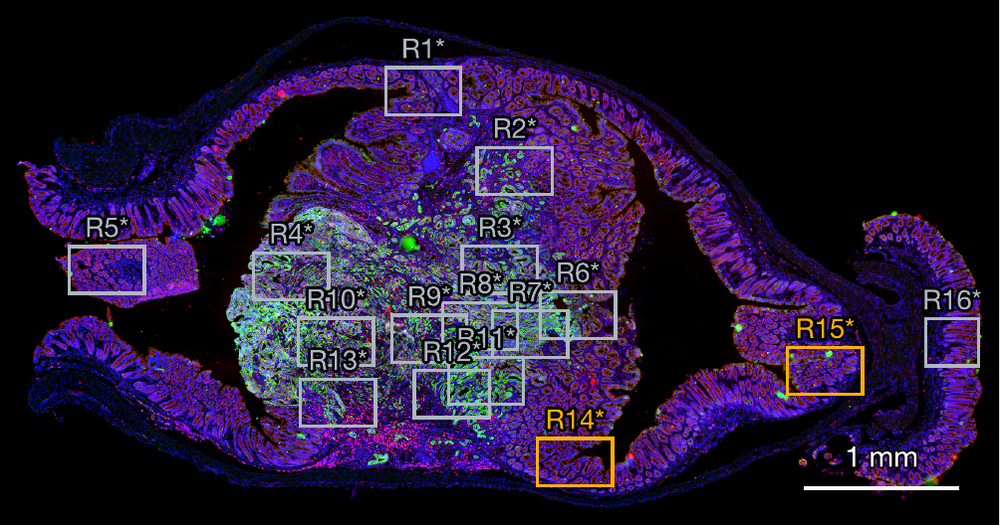
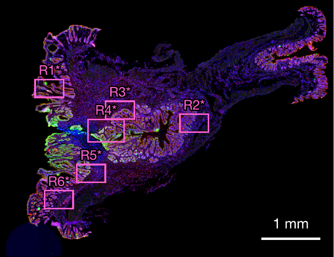
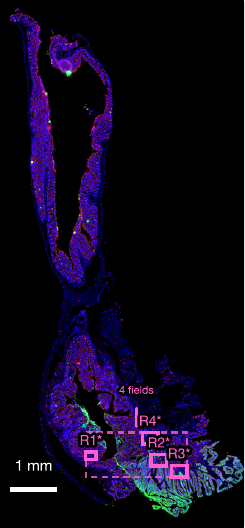
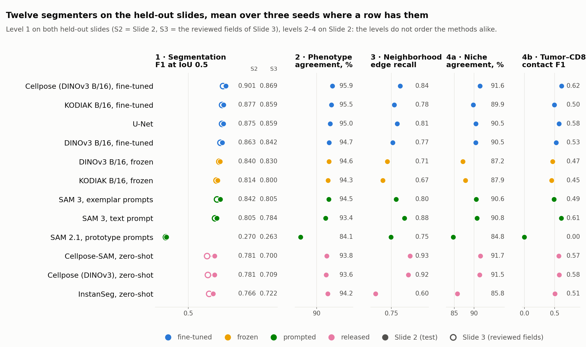

<div align="center">

<picture>
  <source media="(prefers-color-scheme: dark)" srcset="media/logo_dark.png">
  
</picture>

**An expert-curated multiplex-immunofluorescence cell-segmentation benchmark, one leave-slide-out protocol for twelve segmenters, and a four-level evaluation that follows every method's cells into phenotypes, neighborhoods and tumor–immune organization**

[](https://github.com/marjanstoimchev/beyond-segmentation-accuracy/actions/workflows/ci.yml)
[](LICENSE)
[](https://openreview.net/forum?id=mD2Cb5rqWd)
[](https://www.python.org/)
[](https://lightning.ai/)

<a href="https://asci.artificialintelligencepathology.org/">
<picture>
  <source media="(prefers-color-scheme: dark)" srcset="media/venue_dark.png">
  
</picture>
</a>

<sub>Accepted at the NeurIPS 2026 Workshop on <b>AI at Scale for Clinical Impact: Cancer Pathology Foundation Models (ASCI)</b>, Sydney, December 2026 · <a href="https://openreview.net/forum?id=mD2Cb5rqWd">OpenReview</a></sub>

[Quick start](docs/QUICKSTART.md) ·
[Data](docs/DATA.md) ·
[Pipeline](docs/PIPELINE.md) ·
[Experiments](docs/EXPERIMENTS.md) ·
[Notebooks](docs/NOTEBOOKS.md) ·
[Results](docs/RESULTS.md) ·
[Development](docs/DEVELOPMENT.md)

</div>

---

> **Research and non-commercial use only.** This code is released under the
> [PolyForm Noncommercial License 1.0.0](LICENSE): academic, research and other non-commercial use is free;
> commercial use of any kind is not permitted without a separate license (contact the authors).
> If this benchmark or code contributes to your work, please **cite the paper** (see [Citation](#citation)).

**The problem.** Multiplex immunofluorescence (MxIF) resolves cellular identity, state and spatial organization within
tumor tissue, but every downstream representation of the tumor microenvironment — marker quantification, phenotypes,
cell–cell neighborhoods, tumor–immune organization — rests on one deceptively simple first step: finding the individual
cells. Segmentation benchmarks report instance accuracy. They do not say whether a better instance score yields a more
faithful biological picture.

**What this repository does.** It tests that relationship directly. An expert-curated benchmark of more than 21,000
cells on three CellDIVE slides (every cell reviewed, HALO's errors flagged) is scored under a leave-slide-out protocol:
one development slide for pretraining, training and model selection, two slides held out at every stage. Twelve
segmenters — a U-Net, a domain-specific self-supervised encoder ([KODIAK](https://github.com/marjanstoimchev/KODIAK),
adapted to multiplex tissue; "MxIF-SSL" in the anonymized paper), its DINOv3 initialization, frozen-encoder probes,
Cellpose (zero-shot and fine-tuned), InstanSeg, and the prompted generalists SAM 2.1 and SAM 3 — are trained and
evaluated under one protocol, and every method's predicted cells pass through the same downstream pipeline. Fidelity is
measured at four levels: cell segmentation, phenotype assignment, spatial neighborhood structure, and tumor–immune
organization.

<p align="center">
  
</p>
<p align="center"><em>Tumor–CD8<sup>+</sup> contact recovery, the most stringent spatial test, against Panoptic Quality on the test slide
(a; one point per run and region, rings = method means): conventional segmentation quality barely predicts it (ρ = 0.18),
while the coarser infiltration statistics are preserved by almost every method (b–d).</em></p>

**What it finds.** The levels do not improve in lockstep. Phenotype assignment is robust to segmentation differences
(96–97 % lineage agreement for every trained row), whereas missed cells increasingly disrupt neighborhood structure and
tumor–immune interactions. Methods with nearly identical segmentation accuracy produce substantially different
biological representations: at equal Panoptic Quality on the same region, one method keeps 9 of 14 expert tumor–CD8
contacts and another keeps 5.

<p align="center">
  
</p>
<p align="center"><em>One region of the test slide read four ways. Rows: cell classes, tumor–CD8 contacts (black recovered, red lost, blue invented),
CD8 infiltration zones. Columns: the expert reference and three methods with the same PQ and different contact fidelity.</em></p>

This is the official implementation of

> **Beyond Segmentation Accuracy: Evaluating Biological Fidelity in Spatial Pathology**
> N. Dimitrova, M. Stoimchev, A. Filliol, S. Flowers, P. Romesser, S. Lowe
> *NeurIPS 2026 Workshop on AI at Scale for Clinical Impact: Cancer Pathology Foundation Models (ASCI)* ·
> [OpenReview](https://openreview.net/forum?id=mD2Cb5rqWd)

## Highlights

- **An expert-curated benchmark**: 32,816 HALO nuclei on three slides, every one reviewed cell by cell, 7,115 flagged as
  HALO's errors. Models learn only from confirmed cells; flagged cells are neither targets nor false positives.
- **Leave-slide-out**: Slide 1 develops everything (pretraining on its unlabeled tissue, training, checkpoint selection,
  gates, analysis settings); Slides 2 and 3 are touched once, for the final scoring of each finished run.
- **Twelve rows, one protocol**: the same patches, input (LAP2 · — · DAPI, the channels the reference was drawn from),
  optimizer, budget and three seeds for every trained model; zero-shot and prompted rows declared by one YAML each.
- **Four levels of fidelity**: whole-region instance metrics; marker quantification and hierarchical phenotypes under
  calibrated gates; cell-graph edges and neighborhood composition; tumor–CD8 contacts, infiltration and Treg proximity.
- **One data pipeline** (`mxdata`): CellDIVE OME-TIFFs + HALO layers + review tables → a fixed dataset of 256² patches
  carrying every marker, validated, resumable, with the split and normalization stored once and used everywhere.
- **Reproducible from the configs**: every table and figure comes from `configs/`, `scripts/finetune_all.sh` and the
  notebooks; the metrics of every run are versioned here.

## Data

Three CellDIVE whole-slide images of mouse colorectal cancer, one nine-marker panel (DAPI, LAP2, PanCK, CD45, CD3, CD4,
CD8, FOXP3, uPAR) at 0.325 µm per pixel, every annotated region segmented by HALO and then reviewed cell by cell by an
expert, who flags HALO's errors. Models learn only from confirmed cells; flagged cells are neither targets nor false
positives.

<table align="center">
  <tr>
    <td align="center"><br><sub><b>Slide 1</b> · development · 16 regions</sub></td>
    <td align="center"><br><sub><b>Slide 2</b> · test · 6 regions</sub></td>
    <td align="center"><br><sub><b>Slide 3</b> · second test · 4 fields</sub></td>
  </tr>
</table>
<p align="center"><sub>CD8 red · PanCK green · DAPI blue. Annotated regions outlined by role (grey training, amber validation, magenta test); * = expert-reviewed; 1 mm scale bars.</sub></p>

<table align="center">
  <thead>
    <tr>
      <th rowspan="2" align="left">Slide</th>
      <th rowspan="2" align="left">Role under the protocol</th>
      <th colspan="2">Regions</th>
      <th colspan="3">Cells (HALO objects)</th>
      <th colspan="2">256² patches</th>
    </tr>
    <tr>
      <th>all</th><th>reviewed</th>
      <th>all</th><th>confirmed</th><th>flagged <i>wrong</i></th>
      <th>labeled</th><th>unlabeled</th>
    </tr>
  </thead>
  <tbody>
    <tr>
      <td><b>Slide 1</b><br><sub>SLIDE-0235</sub></td>
      <td><b>development</b><br><sub>pretraining · training · model selection (R14, R15) · gate calibration</sub></td>
      <td align="right">16</td><td align="right">16</td>
      <td align="right">21,657</td><td align="right">16,985</td><td align="right">4,668</td>
      <td align="right">628</td><td align="right">4,478</td>
    </tr>
    <tr>
      <td><b>Slide 2</b><br><sub>SLIDE-0236</sub></td>
      <td><b>test</b><br><sub>all four levels, scored once per finished run</sub></td>
      <td align="right">6</td><td align="right">6</td>
      <td align="right">7,662</td><td align="right">6,152</td><td align="right">1,510</td>
      <td align="right">259</td><td align="right">4,103</td>
    </tr>
    <tr>
      <td><b>Slide 3</b><br><sub>SLIDE-0233</sub></td>
      <td><b>second test</b><br><sub>segmentation level, immune-rich fields</sub></td>
      <td align="right">4</td><td align="right">3</td>
      <td align="right">3,451</td><td align="right">1,672</td><td align="right">937</td>
      <td align="right">72</td><td align="right">—</td>
    </tr>
    <tr>
      <td><b>Total</b></td><td></td>
      <td align="right">26</td><td align="right">25</td>
      <td align="right">32,770</td><td align="right">24,809</td><td align="right">7,115</td>
      <td align="right">959</td><td align="right">8,581</td>
    </tr>
  </tbody>
</table>
<p align="center"><sub>Confirmed and flagged cells are those of the reviewed regions; Slide 3's unreviewed field (842 cells) and four Slide 1 contours without a review row are scored nowhere. Unlabeled patches are tissue outside the annotated regions, used for pretraining only.</sub></p>

<table align="center">
  <thead>
    <tr><th align="left">Phenotype labels</th><th align="left">Slide</th><th align="left">Where</th><th>PanCK⁺</th><th>T cell</th><th>CD4⁺ T</th><th>CD8⁺ T</th><th>Treg</th><th align="left">Used for</th></tr>
  </thead>
  <tbody>
    <tr><td>tags on tool polygons</td><td>1</td><td>one 1,024² window in R1</td><td align="right">1,006</td><td align="right">40</td><td align="right">26</td><td align="right">12</td><td align="right">—</td><td>gate calibration</td></tr>
    <tr><td>tags on tool polygons</td><td>2</td><td>four 1,024² windows</td><td align="right">1,982</td><td align="right">188</td><td align="right">147</td><td align="right">71</td><td align="right">80</td><td>held out with the slide</td></tr>
    <tr><td>bounding boxes</td><td>3</td><td>two reviewed fields</td><td align="right">311</td><td align="right">193</td><td align="right">123</td><td align="right">103</td><td align="right">26</td><td>held out with the slide</td></tr>
  </tbody>
</table>
<p align="center"><sub>A label locates a cell; it never defines a boundary, and none of these enter segmentation training or scoring.</sub></p>

**Access.** The slides, annotations and review tables are not distributed with the code: the images are private
clinical research data. Researchers who wish to use the benchmark should contact **Nevenka Dimitrova**, corresponding
author of the paper, for a data-use agreement. The pipeline runs unchanged on any CellDIVE + HALO export placed in the
layout of [docs/DATA.md](docs/DATA.md) (one folder per slide: OME-TIFFs, HALO GeoJSON layers, review tables, phenotype
labels), and the test suite builds a synthetic slide in that layout, so everything here can be exercised without the data.

## Install and run

```bash
pip install torch torchvision                                  # the build for your platform, https://pytorch.org
pip install -e ".[train,kodiak,notebooks,dev]"                 # mxdata + mxseg + kodiak and the notebook stack
make test                                                      # synthetic slides, no data needed, ~1 min

export MXDATA_ROOT=/path/to/slides                             # folder holding SLIDE-*/ (see docs/DATA.md)
make data                                                      # the dataset: $MXDATA_ROOT/dataset/
python -m kodiak.pretrain -c configs/kodiak_pretrain_vitb.yaml # KODIAK ViT-B/16 on the development slide -> runs/kodiak_mxif_vitb
scripts/finetune_all.sh --epochs 10 --zero-shot                # every row x 3 seeds, each scored on the test slides -> results/
```

Then the notebooks, `02 → 03 → 04 → 05` and `analyses/10`, turn the stored predictions into the four-level analysis.
The [quick start](docs/QUICKSTART.md) walks through all of it; [Experiments](docs/EXPERIMENTS.md) lists every row's command.

## Documentation

| | |
|---|---|
| [Quick start](docs/QUICKSTART.md) | Installation, smoke test, data → pretrain → train → evaluate → analyze, where everything lands |
| [Data](docs/DATA.md) | The slides, annotations and review tables; the dataset of patches; the QC rule; the phenotype label store |
| [Pipeline](docs/PIPELINE.md) | ingest → validate → plan → stats → sample → serve, and what makes it resumable and testable |
| [Experiments](docs/EXPERIMENTS.md) | The protocol, every row of the paper as a command, the inputs, KODIAK pretraining on MxIF |
| [Notebooks](docs/NOTEBOOKS.md) | One notebook per analysis, what each reads and writes, in what order to run them |
| [Results](docs/RESULTS.md) | The current numbers on both held-out slides, per level |
| [Development](docs/DEVELOPMENT.md) | Tests, lint, CI, project layout, practices the code follows |

## Results at a glance

<picture>
  <source media="(prefers-color-scheme: dark)" srcset="media/results_dark.png">
  
</picture>

Instance accuracy and the biological endpoint rank the methods differently. The three best segmenters span 0.50–0.62
on tumor–CD8 contact fidelity, zero-shot rows with far lower PQ keep as many contacts as the best fine-tuned ones, and
phenotype agreement barely moves across the whole field. The tables behind the figure, with seeds, intervals and every
metric, are in [docs/RESULTS.md](docs/RESULTS.md).

<details>
<summary><b>Segmentation table, Slide 2</b> (6 regions, 6,152 confirmed cells; mean over three seeds, 10-epoch budget)</summary>

| Method | F1@0.5 | AP@0.5 | AP@0.5:0.9 | PQ | Precision | Recall | Count ratio |
|---|---|---|---|---|---|---|---|
| Cellpose (DINOv3 B/16), fine-tuned | **0.901** | **0.819** | **0.551** | **0.726** | 0.923 | 0.879 | 0.952 |
| KODIAK B/16, fine-tuned | 0.877 | 0.781 | 0.504 | 0.697 | **0.929** | 0.830 | 0.894 |
| U-Net | 0.875 | 0.778 | 0.480 | 0.685 | 0.915 | 0.838 | 0.915 |
| DINOv3 B/16, fine-tuned | 0.863 | 0.759 | 0.451 | 0.665 | 0.924 | 0.809 | 0.875 |
| DINOv3 B/16, frozen | 0.840 | 0.724 | 0.424 | 0.644 | 0.919 | 0.773 | 0.841 |
| KODIAK B/16, frozen | 0.814 | 0.686 | 0.392 | 0.618 | 0.910 | 0.736 | 0.809 |
| SAM 3, exemplar prompts | 0.842 | 0.727 | 0.403 | 0.633 | 0.857 | 0.828 | **0.966** |
| SAM 3, text prompt | 0.805 | 0.674 | 0.308 | 0.568 | 0.768 | 0.846 | 1.102 |
| Cellpose-SAM, zero-shot | 0.781 | 0.641 | 0.292 | 0.550 | 0.701 | **0.883** | 1.261 |
| Cellpose (DINOv3), zero-shot | 0.781 | 0.641 | 0.276 | 0.541 | 0.717 | 0.858 | 1.197 |
| InstanSeg, zero-shot | 0.766 | 0.620 | 0.313 | 0.556 | 0.856 | 0.693 | 0.810 |
| SAM 2.1, prototype prompts | 0.270 | 0.156 | 0.049 | 0.168 | 0.301 | 0.245 | 0.813 |

</details>

<details>
<summary><b>Segmentation table, Slide 3</b> (3 reviewed fields, 1,672 confirmed cells)</summary>

| Method | F1@0.5 | AP@0.5:0.9 | PQ | Precision | Recall | Count ratio |
|---|---|---|---|---|---|---|
| Cellpose (DINOv3 B/16), fine-tuned | **0.869** | **0.515** | **0.700** | 0.870 | **0.868** | **0.998** |
| KODIAK B/16, fine-tuned | 0.859 | 0.496 | 0.687 | **0.886** | 0.834 | 0.942 |
| U-Net | 0.859 | 0.465 | 0.673 | 0.871 | 0.847 | 0.973 |
| DINOv3 B/16, fine-tuned | 0.842 | 0.444 | 0.655 | 0.878 | 0.809 | 0.921 |
| DINOv3 B/16, frozen | 0.830 | 0.419 | 0.638 | 0.881 | 0.785 | 0.891 |
| KODIAK B/16, frozen | 0.800 | 0.390 | 0.613 | 0.860 | 0.748 | 0.870 |
| SAM 3, exemplar prompts | 0.805 | 0.381 | 0.608 | 0.823 | 0.788 | 0.958 |
| SAM 3, text prompt | 0.784 | 0.308 | 0.560 | 0.740 | 0.834 | 1.128 |
| InstanSeg, zero-shot | 0.722 | 0.309 | 0.536 | 0.778 | 0.674 | 0.866 |
| Cellpose (DINOv3), zero-shot | 0.709 | 0.260 | 0.502 | 0.604 | 0.856 | 1.416 |
| Cellpose-SAM, zero-shot | 0.700 | 0.264 | 0.502 | 0.587 | 0.867 | 1.476 |
| SAM 2.1, prototype prompts | 0.263 | 0.050 | 0.166 | 0.296 | 0.237 | 0.799 |

</details>

<details>
<summary><b>The four levels, Slide 2</b> (trained rows; phenotype, neighborhood, niche and tumor–immune fidelity)</summary>

| Method | Lineage agreement % | Phenotype agreement % | Edge recall, all expert edges | Niche agreement % | Tumor–CD8 contact F1 |
|---|---|---|---|---|---|
| Cellpose (DINOv3 B/16), fine-tuned | 96.9 | 95.9 | 0.84 | 91.6 | **0.62** |
| KODIAK B/16, fine-tuned | 96.7 | 95.5 | 0.78 | 89.9 | 0.50 |
| U-Net | 96.3 | 95.0 | 0.81 | 90.5 | 0.58 |
| DINOv3 B/16, fine-tuned | 96.0 | 94.7 | 0.77 | 90.5 | 0.53 |
| DINOv3 B/16, frozen | 95.9 | 94.6 | 0.71 | 87.2 | 0.47 |
| KODIAK B/16, frozen | 95.8 | 94.3 | 0.67 | 87.9 | 0.45 |

Spearman correlation with contact F1 over the 108 run × region points: Panoptic Quality 0.18, F1 0.21, Dice 0.19,
error rate at tumor–immune interfaces −0.80.

</details>

## Citation

If this benchmark or code contributes to your work, please cite the paper:

```bibtex
@inproceedings{dimitrova2026beyond,
  title     = {Beyond Segmentation Accuracy: Evaluating Biological Fidelity in Spatial Pathology},
  author    = {Nevenka Dimitrova and Marjan Stoimchev and Aveline Filliol and Sara Flowers and Paul Romesser and Scott Lowe},
  booktitle = {AI at Scale for Clinical Impact: Cancer Pathology Foundation Models (NeurIPS 2026 Workshop)},
  year      = {2026},
  url       = {https://openreview.net/forum?id=mD2Cb5rqWd}
}
```

The self-supervised encoder is KODIAK; if you use it, please also cite
[its paper](https://github.com/marjanstoimchev/KODIAK#citation).

## License

The code (`src/mxdata`, `src/mxseg`, `src/kodiak`, `scripts/`, `configs/`, `tests/`, `docs/`, `notebooks/`, `media/`) is
released under the [PolyForm Noncommercial License 1.0.0](LICENSE). In short:

- **Allowed**: use, modification and redistribution for research, teaching, personal and other non-commercial purposes,
  including by universities, research institutes and hospitals doing research.
- **Not allowed**: any commercial use (products, services, consulting, commercial R&D) without a separate license.
  For commercial licensing, contact the authors.
- **Please cite and acknowledge** the paper in publications, reports or software that build on this code.

The vendored DINOv3 layers (`src/dinov3/`) are distributed by Meta under the
[DINOv3 License Agreement](src/dinov3/LICENSE.md). The pretrained weights the baselines download (DINOv3, Cellpose,
InstanSeg, SAM 2.1, SAM 3) remain under their own licenses.
